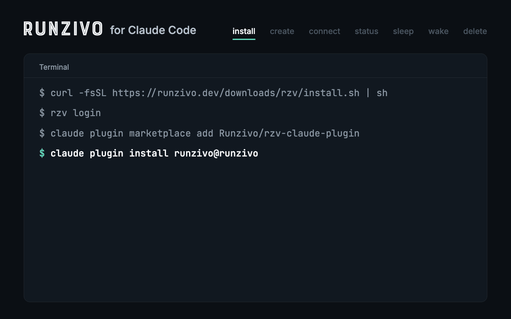

# Runzivo for Claude Code

Run your work in a [Runzivo](https://runzivo.dev) sandbox, a Linux virtual
machine billed by the minute, without leaving Claude Code. This plugin adds
slash commands to create a sandbox, connect to it over SSH or from your
editor, check its time left and credits, put it to sleep, wake it, and delete
it. A skill teaches Claude to run builds and tests in the sandbox over SSH.

[](https://github.com/Runzivo/rzv-claude-plugin/actions/workflows/ci.yml) [](https://github.com/Runzivo/rzv-claude-plugin/releases/latest) [](LICENSE) [](https://runzivo.dev/sandboxes/)



## Install

You need the Runzivo CLI, `rzv` 0.26.0 or later, signed in. Then add this
repository as a marketplace and install the plugin from it:

```sh
curl -fsSL https://runzivo.dev/downloads/rzv/install.sh | sh
rzv login
claude plugin marketplace add Runzivo/rzv-claude-plugin
claude plugin install runzivo@runzivo
```

In a session, `/plugin install runzivo --marketplace Runzivo/rzv-claude-plugin`
does the same. The plugin is in [plugins/runzivo](plugins/runzivo). From 0.1.0,
run `claude plugin marketplace update runzivo`, then `claude plugin update runzivo@runzivo`.

## Commands

| Command | What it does |
| - | - |
| `/runzivo:create [name] [--size S] [--lifetime L] [--disk-gib N]` | Create `claude-<name>`, wait for it and write the `<id>.rzv` SSH alias |
| `/runzivo:connect <id>` | Write the alias; show `ssh <id>.rzv`, VS Code and Cursor commands |
| `/runzivo:status [<id>]` | Status, time left, expiry and credits used |
| `/runzivo:sleep <id>` / `/runzivo:wake <id>` | Stop or start the sandbox |
| `/runzivo:delete <id> [--yes]` | Delete after you confirm |
| `/runzivo:sandbox [<id>] [task]` | Run a task in the sandbox over SSH |

Each skill tells Claude which `rzv` command to run; you approve each one.
Claude can use `connect`, `status` and `sandbox` on its own, but never creates,
wakes, sleeps or deletes a sandbox unless you run the command. Details:
[docs/commands.md](docs/commands.md), [docs/sandbox-work.md](docs/sandbox-work.md).

## What it runs and sends

The plugin is Markdown instructions only: no scripts, hooks, MCP servers or
pre-approved tools. It makes no network calls, stores no tokens, ships no AI
provider keys and reads none of your project files. `rzv` talks to Runzivo
with your own sign-in; Claude copies files to a sandbox over SSH only for work
you ask for there. See [docs/privacy.md](docs/privacy.md).
Sandbox time uses your workspace's equivalent-minute credits. `/workspace`
is kept when a sandbox sleeps; do not rely on anything outside it.

## More

[Troubleshooting](docs/troubleshooting.md) · [Testing](docs/testing.md) ·
[Releasing](docs/releasing.md) · [Changelog](CHANGELOG.md)

MIT licensed. Runzivo service terms: https://runzivo.dev/legal/terms
